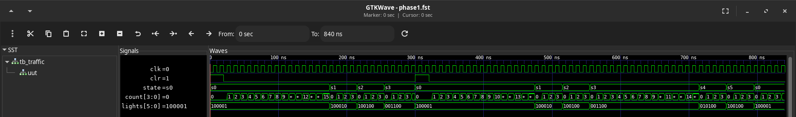
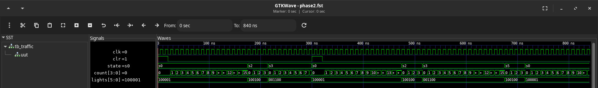
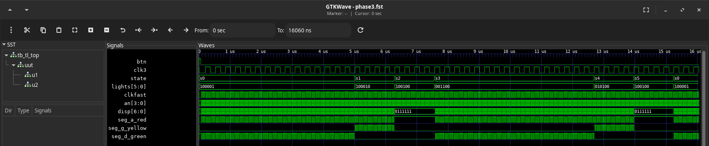
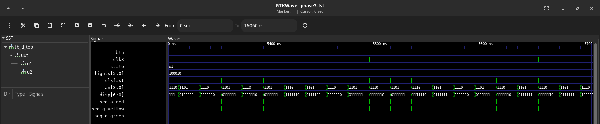

# Εργαστήριο: Traffic Lights (FSM)

**Όνομα:** Μάνος Γεωργουδάκης

**ΑΜ:** TH20550

## Περιγραφή

Το κύκλωμα έχει τρία κομμάτια. Το clkdiv βγάζει από τα 50 MHz ένα αργό ρολόι (clk3) για τη μηχανή καταστάσεων και ένα πιο γρήγορο (clkfast). Το traffic είναι η μηχανή καταστάσεων με 6 καταστάσεις, όπου ένας μετρητής κρατάει πόσο μένουμε σε κάθε κατάσταση. Το tl_top τα συνδέει μεταξύ τους και το κουμπί btn κάνει reset.

| Κατάσταση | Βορράς - Νότος | Ανατολή - Δύση | Καθυστέρηση |
|---|---|---|---|
| s0 | Πράσινο | Κόκκινο | 5 s |
| s1 | Κίτρινο | Κόκκινο | 1 s |
| s2 | Κόκκινο | Κόκκινο | 1 s |
| s3 | Κόκκινο | Πράσινο | 5 s |
| s4 | Κόκκινο | Κίτρινο | 1 s |
| s5 | Κόκκινο | Κόκκινο | 1 s |

Στην έξοδο lights τα 3 πάνω bit είναι το φανάρι Ανατολής-Δύσης και τα 3 κάτω του Βορρά-Νότου (κόκκινο, κίτρινο, πράσινο).

## 1. Αρχείο περιορισμών

| Σήμα | Ακροδέκτης | Πλακέτα |
|---|---|---|
| clk | T9 | Ρολόι 50 MHz |
| btn | L14 | BTN3 (reset) |
| ld(0) | K12 | Βορράς-Νότος πράσινο |
| ld(1) | P14 | Βορράς-Νότος κίτρινο |
| ld(2) | L12 | Βορράς-Νότος κόκκινο |
| ld(3) | N14 | Ανατολή-Δύση πράσινο |
| ld(4) | P13 | Ανατολή-Δύση κίτρινο |
| ld(5) | N12 | Ανατολή-Δύση κόκκινο |

Στον κώδικα που δόθηκε, η s2 πήγαινε στην s3 μετά από έναν μόνο παλμό, γιατί και οι δύο κλάδοι του if έλεγαν `state <= s3`. Το διόρθωσα σε `state <= s2` ώστε να κρατάει όσο οι άλλες καταστάσεις του 1 s.



Φαίνεται η σειρά s0 → s1 → s2 → s3 → s4 → s5. Στα 300 ns πατάω reset και γυρίζει στην s0.

## 2. Χωρίς το κίτρινο

Έβγαλα τις s1 και s4. Τώρα μετά την s0 πάει στην s2 και μετά την s3 στην s5.

```vhdl
type state_type is (s0, s2, s3, s5);
```



Η σειρά είναι s0 → s2 → s3 → s5 και το κίτρινο δεν ανάβει ποτέ.

## 3. Seven-Segment Display

Κάθε φανάρι είναι ένα ψηφίο: το δεξί για Βορρά-Νότο και το αριστερό για Ανατολή-Δύση. Το πάνω segment (a) είναι το κόκκινο, το μεσαίο (g) το κίτρινο και το κάτω (d) το πράσινο.

Τα ψηφία έχουν κοινά segments, οπότε δεν μπορούν να δείχνουν διαφορετικά πράγματα ταυτόχρονα. Γι' αυτό ανάβουν εναλλάξ με το clkfast, αρκετά γρήγορα ώστε να φαίνονται και τα δύο αναμμένα.

```vhdl
ryg <= lights(5 downto 3) when clkfast = '1' else lights(2 downto 0);
an  <= "1101" when clkfast = '1' else "1110";

disp(6) <= not ryg(2);   -- a: κόκκινο
disp(3) <= not ryg(0);   -- d: πράσινο
disp(0) <= not ryg(1);   -- g: κίτρινο
```

Η οθόνη είναι active-low, γι' αυτό το not. Συνέδεσα και τα 4 an και όλα τα segments, όχι μόνο τα 2 και τα 3 που χρειάζονται, και τα αχρησιμοποίητα τα έδωσα '1'. Αλλιώς θα έμεναν στο '0' και θα άναβαν.

Για την προσομοίωση άλλαξα τον διαιρέτη ρολογιού ώστε να διαιρεί με 16. Με τον κανονικό, ένας πλήρης κύκλος των φαναριών θα χρειαζόταν πάνω από ένα δισεκατομμύριο κύκλους ρολογιού. Γι' αυτό στις εικόνες οι χρόνοι είναι σε μs αντί για δευτερόλεπτα.





Στη δεύτερη εικόνα είμαστε στην s1, όπου ο Βορράς-Νότος έχει κίτρινο και η Ανατολή-Δύση κόκκινο. Όταν είναι ενεργό το δεξί ψηφίο ανάβει μόνο η μεσαία γραμμή (κίτρινο) και όταν είναι ενεργό το αριστερό μόνο η πάνω γραμμή (κόκκινο).
